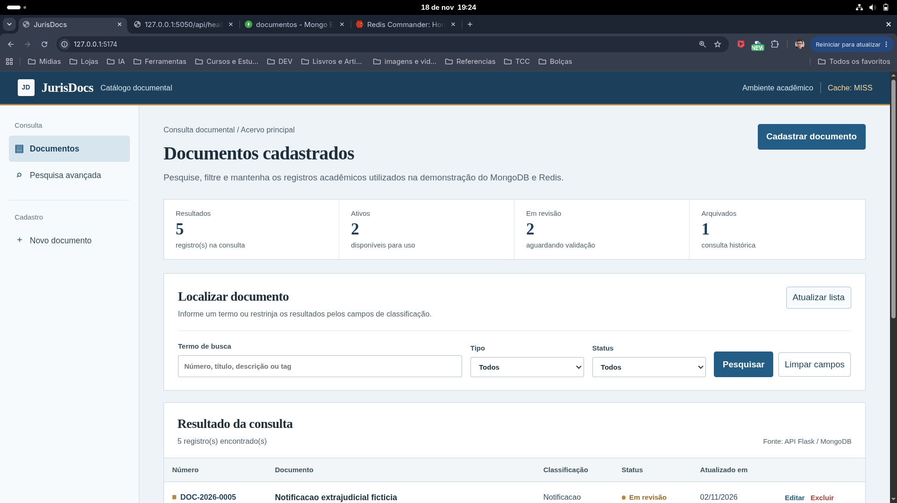
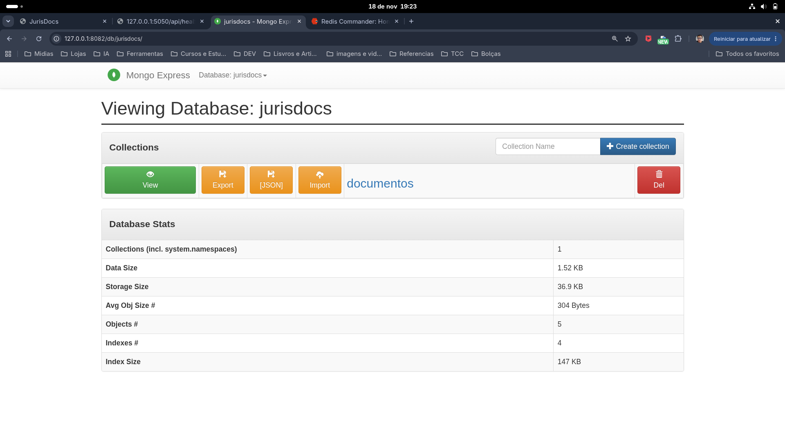
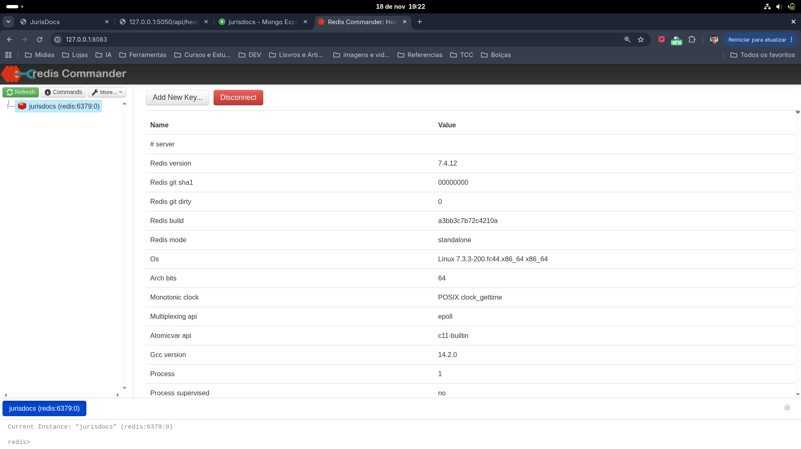

# JurisDocs

> Catálogo acadêmico de documentos jurídicos fictícios, construído para demonstrar MongoDB e Redis em uma aplicação web conteinerizada.

O JurisDocs oferece cadastro, consulta, filtro, edição e exclusão de documentos fictícios. O MongoDB é a fonte persistente de verdade; o Redis aplica o padrão *cache-aside* às leituras. A solução é executada integralmente com Podman Compose, sem instalar bancos de dados no sistema hospedeiro.

> **Escopo acadêmico:** os documentos exibidos são fictícios. O projeto não armazena casos reais e não fornece orientação jurídica.

## Demonstração

| Aplicação | Persistência | Cache |
| --- | --- | --- |
|  |  |  |

## Arquitetura

```text
Navegador
   │ http://127.0.0.1:5174
   ▼
React + Nginx ── /api ──► Flask + Gunicorn
                                  │
                    ┌─────────────┴─────────────┐
                    ▼                           ▼
            MongoDB 8.0                    Redis 7.4
          persistência principal       cache-aside com TTL
```

| Camada | Tecnologia | Responsabilidade |
| --- | --- | --- |
| Interface | React, Vite e Nginx | CRUD, filtros e visualização do estado de cache |
| API | Flask, Gunicorn, PyMongo e redis-py | Regras de negócio, validação, API REST e cache-aside |
| Banco principal | MongoDB 8 | Coleção `documentos`, índices e dados persistentes |
| Cache | Redis 7 | Respostas temporárias, TTL de 60 segundos e invalidação após escrita |
| Orquestração | Podman Compose | Serviços isolados, rede e volumes nomeados |

## Recursos implementados

- CRUD completo de documentos fictícios;
- pesquisa textual e filtros por tipo e status;
- número de documento único;
- índices MongoDB de unicidade, texto e classificação;
- cache-aside Redis com cabeçalho `X-Cache: MISS`, `HIT` ou `BYPASS`;
- invalidação do cache após criação, edição e exclusão;
- fallback para MongoDB quando o Redis está indisponível;
- dados iniciais idempotentes, healthchecks e testes automatizados;
- Mongo Express e Redis Commander para demonstração visual dos bancos.

## Início rápido

### Pré-requisito

Instale somente Podman e o provedor `podman compose`. MongoDB, Redis, Python, Node.js e Nginx são executados nos contêineres.

```bash
git clone https://github.com/LuanAlvesCamargo/JurisDocs.git
cd JurisDocs
chmod +x scripts/*.sh
./scripts/01_subir_infraestrutura.sh
./scripts/02_configurar_bancos.sh
podman compose -p jurisdocs up -d --build
podman compose -p jurisdocs ps
```

Para uma explicação completa, consulte o [tutorial de execução](planejamento/TUTORIAL_EXECUCAO_PODMAN.md).

## Serviços locais

| Serviço | Endereço | Uso |
| --- | --- | --- |
| JurisDocs | [127.0.0.1:5174](http://127.0.0.1:5174) | Interface web e CRUD |
| API / saúde | [127.0.0.1:5050/api/health](http://127.0.0.1:5050/api/health) | Estado da API, MongoDB e Redis |
| Mongo Express | [127.0.0.1:8082](http://127.0.0.1:8082) | Banco, coleção, documentos e índices |
| Redis Commander | [127.0.0.1:8083](http://127.0.0.1:8083) | Chaves e informações da instância Redis |

As portas de MongoDB e Redis são vinculadas a `127.0.0.1`; elas não ficam expostas à rede local.

## Verificação

```bash
podman compose -p jurisdocs exec -T api python -m pytest -q
./scripts/03_validar_fallback_redis.sh
curl http://127.0.0.1:5050/api/health
```

O script de fallback interrompe somente o Redis de forma temporária, confirma leitura via MongoDB com `X-Cache: BYPASS` e restaura o serviço automaticamente.

## Estrutura do repositório

```text
JurisDocs/
├── api/                         # API Flask, regras de cache e testes
├── frontend/                    # React, Vite e Nginx
├── scripts/                     # Preparação, configuração e validação
├── docs/                        # Arquitetura, API e imagens versionadas
├── relatorio/                   # Relatório técnico-científico (.docx e .pdf)
├── compose.yaml                 # Serviços do Podman Compose
├── planejamento/                # Planejamento, enunciado e tutorial
└── ROTEIRO_DEMONSTRACAO.md      # Sequência sugerida para vídeo
```

## Documentação

| Documento | Conteúdo |
| --- | --- |
| [Planejamento](planejamento/PLANEJAMENTO_JURISDOCS.md) | escopo, objetivos, dados, riscos e critérios de aceite |
| [Tutorial de execução](planejamento/TUTORIAL_EXECUCAO_PODMAN.md) | preparação, execução, testes e desligamento |
| [Arquitetura](docs/ARQUITETURA.md) | fluxo dos dados, serviços, volumes e estratégia de cache |
| [Referência da API](docs/API.md) | rotas REST, parâmetros e respostas esperadas |
| [Roteiro de demonstração](ROTEIRO_DEMONSTRACAO.md) | sequência para vídeo e capturas de evidência |
| [Relatório técnico-científico](relatorio/Relatorio_Tecnico_Cientifico_JurisDocs.pdf) | documentação acadêmica final em PDF |

## Autores

- Luan Camargo
- Matheus Andrade Danno
